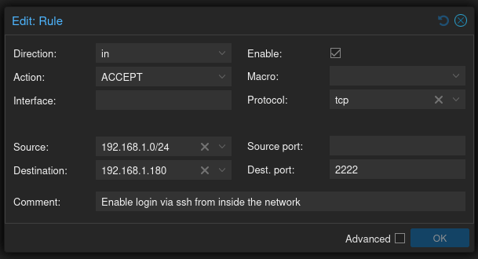
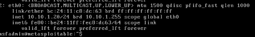
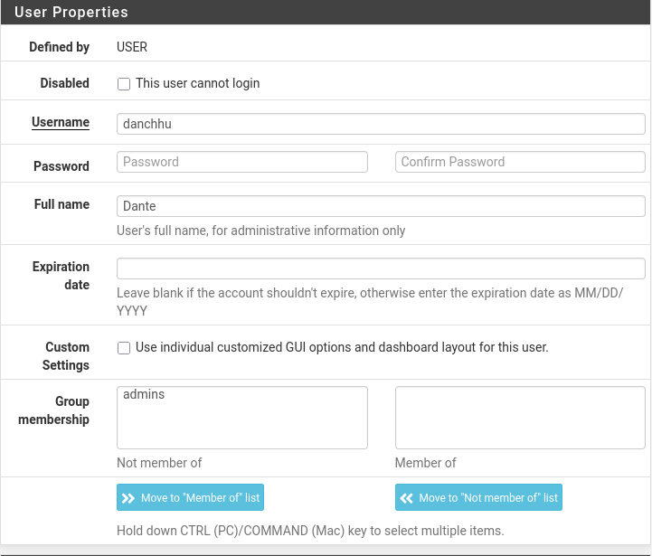
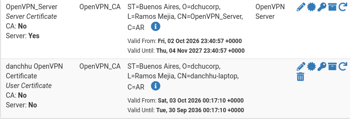
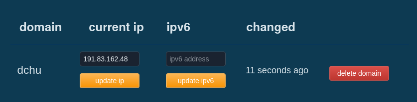
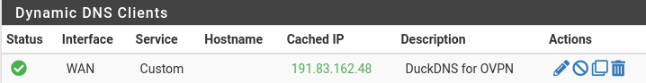

# Homelab: Proxmox VE + pfSense — segmentación y acceso remoto

Laboratorio propio montado sobre hardware reutilizado, con el objetivo de practicar
administración de sistemas, segmentación de red y despliegue de servicios en un
entorno aislado pero accesible de forma remota.

> Entorno propio. Todos los cambios se probaron acá antes de tocar cualquier otra cosa.

## Hardware y capa base

| Componente | Detalle |
|---|---|
| Host | Lenovo ThinkCentre M920s SFF — Core i5 9.ª gen |
| RAM | 40GB |
| Disco | 1 TB NVMe |
| Hypervisor | Proxmox VE 8.x |
| Uplink | Cable a un AP del router doméstico (`192.168.1.0/24`) |

## Topología

```
Internet
   │
Router doméstico (192.168.1.0/24)
   │
vmbr0 (WAN, vtnet0)
   │
pfSense ── vmbr99 (trunk, vtnet1)
   │
   ├── VLAN 10 → máquinas atacantes
   ├── VLAN 20 → objetivos vulnerables
   └── VLAN 30 → AD
```

## Plan de direccionamiento

| Interfaz | Dispositivo | Subred | Rango DHCP | Función |
|---|---|---|---|---|
| WAN (`vtnet0`) | Router doméstico | `192.168.1.0/24` | `192.168.1.33–178` | Salida a Internet |
| LAN base (`vtnet1`) | pfSense | `10.10.10.1/24` | `10.10.10.100–200` | Trunk hacia VLANs |
| VLAN 10 | pfSense | `10.10.1.1/24` | `10.10.1.20–150` | Máquina atacante |
| VLAN 20 | pfSense | `10.10.2.1/24` | `10.10.2.20–150` | Objetivos vulnerables |
| VLAN 30 | pfSense | `10.10.3.0/24` | — | Definida para VPN |

La separación por VLAN es el punto central del diseño: el tráfico entre la máquina
atacante y los objetivos pasa por el firewall, y el resto de la red doméstica queda
fuera del alcance.

## pfSense: puesta en marcha

El primer problema fue quedar bloqueado fuera del WebGUI: la interfaz WAN tenía
activadas las opciones *Block private networks* y *Block bogon networks*, y sin
regla de firewall no había forma de administrarlo.

Runbook que quedó documentado:

1. Acceder por consola (`8) Shell`) y desactivar el filtro: `pfctl -d`
2. En `Interfaces > WAN`, destildar *Block private networks* y *Block bogon networks*.
3. Crear una regla de pass en `Firewall > Rules > WAN`.
4. Reactivar el filtro: `pfctl -e`


## Hardening del host Proxmox

El nodo venía con acceso root por SSH y sin usuario de administración. Se creó un
usuario con sudo y se restringió el acceso:

```bash
adduser admin_user
usermod -aG sudo admin_user
```

```ini
# /etc/ssh/sshd_config
PermitRootLogin no
PasswordAuthentication no
AllowUsers admin_user
Port 2222
```

Además se habilitó el firewall de datacenter para restringir el acceso por clave
desde dentro de la WAN:



## Importar una VM existente (Metasploitable 2)

Metasploitable se distribuye como disco ya instalado, no como ISO. El flujo fue
crear una VM vacía e importar el disco:

```bash
qm importdisk 101 /tmp/Metasploitable2-Linux/Metasploitable.vmdk local-lvm
qm set 101 -ide0 local-lvm:vm-101-disk-1
qm set 101 -bios seabios -boot order=ide0
```

Quedó dentro de la VLAN 10, sin ruta hacia la red doméstica:



## Acceso remoto: OpenVPN + DDNS

El objetivo era entrar al laboratorio desde afuera sin exponer servicios.

- **Túnel:** `10.10.100.0/24`
- **Redes accesibles:** `192.168.1.0/24`, `10.10.1.0/24`, `10.10.2.0/24`, `10.10.3.0/24`
- **CA propia:** `OpenVPN_CA`, con certificado por cliente emitido desde ella.




Como la IP pública es dinámica, se configuró DDNS en pfSense (`Services > Dynamic DNS`)
con un proveedor tipo DuckDNS:




### El problema que costó más caro

El cliente conectaba pero el handshake TLS fallaba a los 60 segundos:

```
TLS Error: TLS key negotiation failed to occur within 60 seconds
TLS Error: TLS handshake failed
```

Hipótesis inicial: el puerto 1194 estaba filtrado. Se abrió en el router y siguió
fallando. La causa real era otra: **el WAN del router doméstico estaba mal
configurado y la interfaz habilitada era la IP secundaria**, así que el port
forwarding apuntaba a una IP que no era la del pfSense. Se corrigió apuntando la DMZ
a la IP correcta y la conexión funcionó, incluso desde redes externas.


## Servicios desplegados

- **JuiceShop** y **WebGoat** en un contenedor LXC (Debian 13) dentro de la VLAN 10,
  como blancos de práctica web.
- **Metasploitable 2** como objetivo clásico de post-explotación.
- **Windows Server / Active Directory** en despliegue (DC, usuarios, grupos y GPO).

## Troubleshooting que quedó documentado

| Síntoma | Causa | Solución |
|---|---|---|
| Sin acceso al WebGUI de pfSense | *Block private networks* en WAN | `pfctl -d`, ajustar interfaces, `pfctl -e` |
| Handshake TLS de OpenVPN falla | Port forwarding a la IP equivocada del router | Corregir DMZ / interfaz WAN |
| xrdp muestra pantalla negra | No había entorno de escritorio instalado | Instalar el DE antes de configurar xrdp |
| VM importada no bootea | Disco sin orden de arranque / BIOS UEFI | `-bios seabios -boot order=ide0` |

## Pendientes

- Completar el dominio Active Directory y las GPO.
- Sumar Wazuh o ELK para centralizar logs del DC y de la red.
- Automatizar backups verificables (no solo snapshots).
